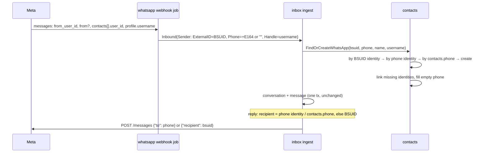

# Phase 10 plan: WhatsApp user IDs (usernames)

**Status:** built 2026-11-06 (one PR). Decisions: [ADR 0015](adr/0015-whatsapp-user-ids.md).

A customer who has a WhatsApp username can write to a connected number without Meta telling us their phone. Their message must land in the Inbox, and agents, automations and quick replies must be able to answer. Today the webhook job fails with `invalid_phone` and the message is lost after River's retries.

## 1. Requirements

### Functional

- An inbound message with `from_user_id` and no `from` creates (or finds) a contact and a conversation, like any other message.
- An inbound message with both IDs finds the contact by either, and links the missing one.
- A contact without a phone shows its WhatsApp name and `@username` in the Inbox (list, thread header, customer panel) and on Contacts (list, panel). Search finds it by name or username.
- Replies, templates in the window, media, reactions and automation sends reach a phone-less contact through its user ID.
- Broadcasts leave phone-less contacts out, and the audience preview counts them as `no_phone`.
- Contacts created by hand, import, API or commerce still need a phone. Editing a phone-less contact may leave the phone empty; adding one links it.

### Non-functional

- Redelivered webhooks stay harmless (wamid dedupe is unchanged).
- Two webhooks for the same new user at once create one contact (the identity primary key decides; the loser reads the winner's link, as today).
- No extra Graph calls; one more indexed identity lookup per inbound message at most.

### Out of scope

Merging duplicate contacts, the `system` webhook for phone changes, parent BSUIDs, sending broadcasts to user IDs, and showing the user ID itself in the UI.

## 2. Data

| Change                                                                                                             | Migration                                               |
| ------------------------------------------------------------------------------------------------------------------ | ------------------------------------------------------- |
| `contacts.phone` drops `NOT NULL`                                                                                  | `ALTER TABLE contacts ALTER COLUMN phone DROP NOT NULL` |
| `broadcast_recipients.phone` stays `NOT NULL`; phone-less contacts aren't inserted                                 | none                                                    |
| `contact_identities` unchanged: WhatsApp rows hold a phone (`+…`) or a BSUID (`CC.…`); `handle` holds the username | none                                                    |

Down migration: refuses (fails) if any contact has no phone, so a rollback never deletes contacts silently.

## 3. Flow

## 4. Change list by layer

API:

1. Migration `whatsapp_user_ids`: `contacts.phone` nullable.
2. `contacts/repository`: phone columns become `*string` in generated code; identity upsert stores `handle`; a query to fill an empty phone; search matches identity handles.
3. `contacts/service`: `FindOrCreateByIdentity` takes the sender's extra IDs (phone, handle) and follows ADR 0015's lookup order. `ErrIdentityNeedsPhone` goes away. Manual create, import and API keep requiring a phone.
4. `whatsapp/service/inbox_webhook.go`: parse `from_user_id`, `contacts[].user_id`, `profile.username`; the sender's external ID is the BSUID when present, else the phone. Statuses parse `recipient_user_id` (kept for logs only).
5. `whatsapp/service/messages_graph.go`: an address that is a BSUID goes in `recipient`, a phone in `to`.
6. `inbox/repository/messages_queries.sql` `GetMessageToSend`: recipient = newest WhatsApp phone identity, else `contacts.phone`, else newest identity.
7. `inbox`, `contacts` DTOs: `phone` stays a string, empty when unknown (queries `COALESCE` it); contacts expose `whatsapp_username`, conversation contacts `username`.
8. `broadcasts`: the recipient snapshot requires `c.phone IS NOT NULL`; the audience count returns `no_phone`.
9. `seed_dev.go`: one phone-less contact with a username and a short chat in Green Leaf Store.
10. Tests: webhook parsing for the three payload shapes (phone only, both, BSUID only); contact lookup/link order; Graph body `to` vs `recipient`; an `internal/app` flow test from webhook to inbox to reply job.

Web (after `task gen`):

11. Contacts and inbox components render `phone ?? '@username' ?? 'WhatsApp user'`; contact form allows an empty phone only when editing a contact that has none.
12. Broadcast audience copy for `no_phone`.

## 5. Build plan

One PR (`feat: WhatsApp user IDs for username senders`), because the new API fields and the web must change together. Commits in this order: migration + contacts, WhatsApp webhook + Graph, inbox recipient, broadcasts, DTOs + `task gen`, web, seed + tests.

## 6. Rollout

- No flag: the change only accepts messages that fail today.
- Deploy runs the migration first; it's a metadata-only `ALTER` (no rewrite).
- Failed `whatsapp_webhook` jobs still in retry succeed on their next attempt after deploy. Jobs already discarded aren't replayed.
- Rollback: revert the code; the down migration refuses while phone-less contacts exist.
