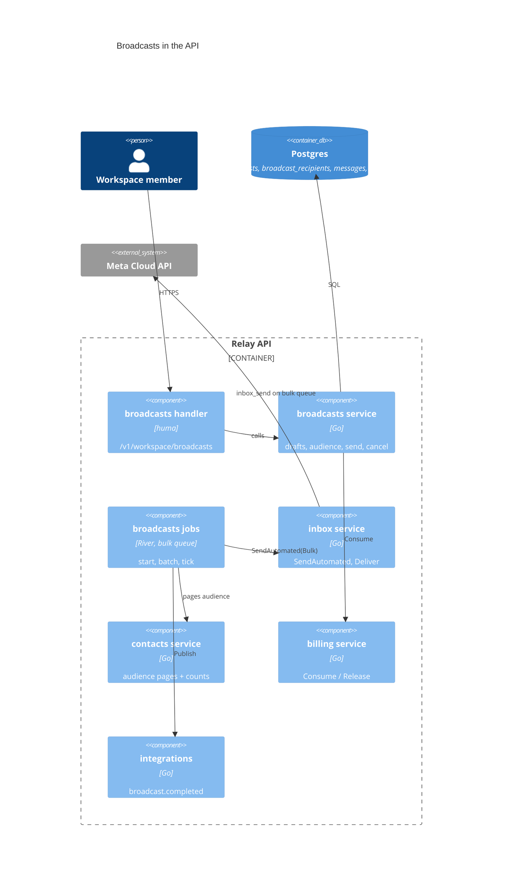
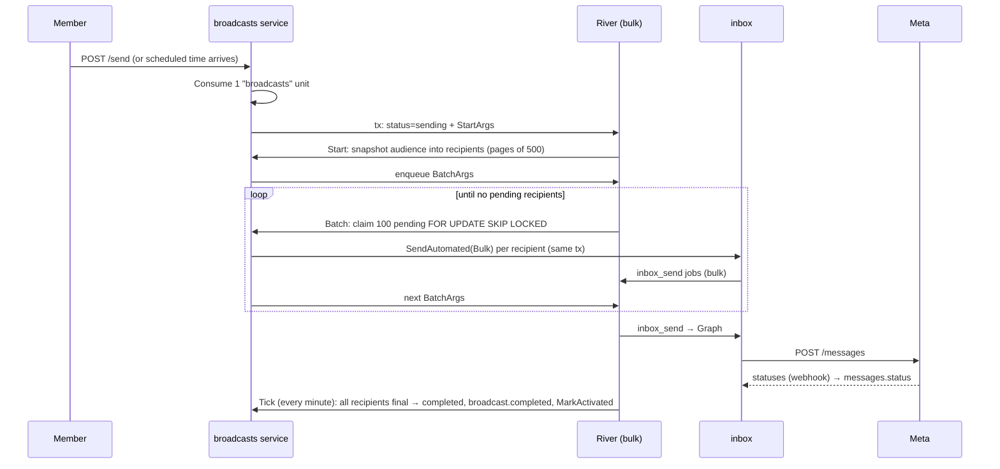

# Phase 9 plan: Broadcasts

**Status:** built 2026-10-31, BC-1 to BC-5 (section 10 lists what changed while building). Decisions: [ADR 0013](adr/0013-broadcasts.md). There is no design canvas; the UI follows the Templates (list + editor + preview) and Automations (cards, drawers, variable rows) pages.

A workspace member picks an approved template, chooses who gets it, fills its variables, previews it and sends now or later. The broadcast's page shows live counts: sent, delivered, read, replied, failed.

## 1. Requirements

### Functional

- **List** (`/broadcasts`): name, template, audience size, status, sent/delivered/read rates, scheduled or sent time. Filter by status, search by name. Empty state with "New broadcast".
- **Editor** (`/broadcasts/new`, `/broadcasts/$broadcastId` while draft or scheduled):
  - name;
  - WhatsApp number (default: the workspace's first connected one);
  - approved template (reuse the automations `template-select`);
  - audience: all opted-in contacts, or opted-in contacts with any of the chosen tags; live count plus "N left out (pending or opted out)";
  - variables: each `{{n}}` is fixed text or a contact field (name, phone, an attribute) with a fallback;
  - live preview (reuse the templates `template-preview`);
  - send now, or schedule for a time (workspace time zone).
  - Warnings: audience larger than the number's Meta tier; marketing template cost note.
- **Report** (`/broadcasts/$broadcastId` once sending): progress, counts by status, failure reasons grouped, recipients table (contact, status, time, error), cancel while sending or scheduled, duplicate.
- **Permissions:** `broadcasts.create` saves drafts; `broadcasts.send` sends, schedules, cancels; `broadcasts.reports` sees the list and reports. Agents and viewers see reports only.
- **Plan limit:** the monthly `broadcasts` resource is enforced; at the cap, sending returns `409 plan_broadcast_limit` and the editor shows the meter and an upgrade link.
- **Elsewhere:** the sidebar "Broadcasts" link goes live; `broadcast.completed` webhook fires; the onboarding "Send your first broadcast" item ticks.

### Non-functional

- A contact gets a given broadcast at most once, whatever retries happen.
- Agent replies and automations aren't slowed by a big broadcast.
- 10,000 recipients finish queuing in under 10 minutes on default settings.
- No message to an opted-out contact, ever.

### Out of scope (section 8)

Segments beyond tags, A/B tests, per-broadcast header media, cost per broadcast in billing's campaigns table, recurring broadcasts, SSE progress.

## 2. Estimates

Order of magnitude, for planning only.

| Item                   | Assumption                                      | Result                      |
| ---------------------- | ----------------------------------------------- | --------------------------- |
| Broadcasts             | 100 active workspaces × 5 per month             | ~500 / month                |
| Messages               | × 2,000 recipients average                      | ~1M / month, ~0.4 msg/s avg |
| Peak                   | one 10,000-recipient send                       | 10k jobs in minutes         |
| Throughput             | 4 bulk workers × ~5 Graph calls/s               | ~20 msg/s → 10k in ~8 min   |
| `broadcast_recipients` | ~150 B/row                                      | ~150 MB / month             |
| Meta limits            | tier 1k/10k/100k unique users per 24 h, ~80 mps | not reached at 20 msg/s     |

At 10×: raise `QUEUE_BULK_MAX_WORKERS` (Meta allows ~80 mps per number), prune recipient rows older than 12 months, consider a per-number token bucket.

## 3. High-level design





**Errors from `SendAutomated`** map to the recipient row, like automations: opted out → `skipped/opted_out`; template unavailable or missing variable → `failed/<reason>`; anything else → the batch job retries.

**Header media:** the template's stored header media is used; no per-broadcast override.

## 4. Architecture decisions

See ADR 0013 for the full text. In short:

- **AD-1 Boundaries.** `features/broadcasts` owns `broadcasts` and `broadcast_recipients`. It declares `Inbox`, `Audience`, `Templates`, `Usage`, `Events`, `Activation`, `Enqueuer`; adapters live in `internal/app/broadcasts_adapters.go`.
- **AD-2 Idempotency.** Recipient rows, claimed `FOR UPDATE SKIP LOCKED`, message id stored in the same transaction. River args unique by broadcast id (+ batch cursor).
- **AD-3 Bulk queue.** Second River queue `bulk`; broadcast jobs and their `inbox_send` jobs use it.
- **AD-4 Limit unit.** One broadcast = one unit of the monthly `broadcasts` resource.
- **AD-5 Audience.** `opt_in = 'in'`, optional any-of tags, snapshotted at start, not at save.
- **AD-6 Derived stats.** Counts come from `messages` via `message_id`; replies are inbound messages in the same conversation after `sent_at`.
- **AD-7 Completion tick.** One periodic job marks completion, publishes the webhook and activates onboarding.
- **AD-8 Polling.** 5 s refetch while `sending`.

## 5. Data

```sql
-- broadcasts: one campaign
id uuid PK, workspace_id uuid NOT NULL REFERENCES workspaces,
name text NOT NULL, number_id uuid NOT NULL,          -- whatsapp_numbers.id
template_id uuid NOT NULL,                            -- message_templates.id
audience jsonb NOT NULL DEFAULT '{}',                 -- {"tag_ids": [...]}; empty = all opted-in
variables jsonb NOT NULL DEFAULT '[]',                -- [{"source":"text|name|phone|attribute","value":"","fallback":""}]
status text NOT NULL CHECK (status IN ('draft','scheduled','sending','completed','cancelled','failed')),
scheduled_at timestamptz, started_at timestamptz, completed_at timestamptz,
recipients_total int NOT NULL DEFAULT 0,              -- set once the snapshot is taken
failure_reason text,
created_by uuid, created_at timestamptz, updated_at timestamptz
INDEX (workspace_id, id DESC); INDEX (status, scheduled_at) WHERE status IN ('scheduled','sending')

-- broadcast_recipients: one row per contact per broadcast; the idempotency record
workspace_id uuid NOT NULL, broadcast_id uuid NOT NULL REFERENCES broadcasts ON DELETE CASCADE,
contact_id uuid NOT NULL,                              -- no FK: a deleted contact keeps its report row
phone text NOT NULL, name text NOT NULL DEFAULT '',
state text NOT NULL CHECK (state IN ('pending','queued','skipped','failed')),
reason text, message_id uuid, queued_at timestamptz,
PRIMARY KEY (broadcast_id, contact_id)
INDEX (broadcast_id, state); UNIQUE (message_id)

-- billing: usage_counters (ADR 0008)
workspace_id uuid, resource text, period_start date, used int NOT NULL DEFAULT 0,
PRIMARY KEY (workspace_id, resource, period_start)
```

- Every query takes `workspace_id` and lists its columns.
- `Consume`: `INSERT … ON CONFLICT DO UPDATE SET used = used + $n WHERE used + $n <= $limit RETURNING used`; no row back → limit reached. Runs before the send transaction (ADR 0008 accepts the one-off overcount).
- Deleting a contact leaves its recipient row, so reports stay true.
- Isolation: read committed (Postgres default) is enough. The only race is two batch jobs on one broadcast, and `SKIP LOCKED` covers it.

## 6. API (`/v1/workspace/broadcasts`, `X-Workspace-ID`)

| Method | Path                        | Permission | Does                                                  |
| ------ | --------------------------- | ---------- | ----------------------------------------------------- |
| GET    | `/`                         | reports    | list, cursor, `status`, `q`                           |
| POST   | `/`                         | create     | create draft                                          |
| GET    | `/{broadcastId}`            | reports    | broadcast + counts                                    |
| PATCH  | `/{broadcastId}`            | create     | edit a draft or scheduled broadcast                   |
| DELETE | `/{broadcastId}`            | create     | delete a draft                                        |
| POST   | `/audience/preview`         | create     | `{tag_ids}` → `{included, left_out, over_tier_limit}` |
| POST   | `/{broadcastId}/send`       | send       | `{scheduled_at?}` → sending or scheduled              |
| POST   | `/{broadcastId}/cancel`     | send       | stop                                                  |
| POST   | `/{broadcastId}/duplicate`  | create     | new draft from it                                     |
| GET    | `/{broadcastId}/recipients` | reports    | cursor, `status` filter                               |

Errors: `broadcast_not_editable`, `broadcast_empty_audience`, `plan_broadcast_limit` (409), `template_not_approved`, `number_not_connected` (422).

## 7. Reliability and operations

- **Retries:** River retries batch and start jobs (5 attempts); `inbox_send` keeps its own retry rules (130429 and 5xx retry, 131026 fails).
- **Stuck broadcast:** the tick fails a broadcast still `sending` with pending recipients after 24 h (`failure_reason = stalled`) and logs it.
- **Logs:** every job logs `workspace_id`, `broadcast_id`, batch size, queued/skipped/failed counts.
- **Rollout:** migrations are additive. The nav link and routes ship in BC-4; until then the API exists but nothing calls it. Rollback: hide the nav link; scheduled broadcasts can be cancelled from the API.
- **Score (system-design diagnostic): 8/10.** Requirements, estimates, DB plan, queues, monitoring and rollout pass. Not done: redundancy beyond managed Postgres (accepted at this scale), and no cache (none needed; report counts are one indexed aggregate).

## 8. Build plan

Each PR passes CLAUDE.md section 3 before review. File boundaries: only BC-1 edits `features/billing`; only BC-2 edits `features/inbox` and `platform/queue`; BC-5 is the only one touching `apps/web/src/features/contacts`.

- **BC-1 Monthly usage counters (billing).** Migration `usage_counters`; `Consume`/`Release`/`Usage`; `GET /v1/workspace/billing/usage`; the billing usage card's broadcasts meter reads real counts. Tests: cap, first use over the cap, unlimited, not included, 20 concurrent consumes at a cap of 5, release across a month boundary.
- **BC-2 Bulk sends in the inbox.** `platform/queue` second queue + `QUEUE_BULK_MAX_WORKERS`; `AutomatedText` gains `Bulk`, `NumberID`, `Source`; `SendAutomated` returns the message id; conversation source `broadcast`. Tests: bulk send lands on `bulk`; automations unchanged.
- **BC-3 Broadcasts API.** `broadcasts` → `Enforced` plus its `limits_test.go` entry (the limit is checked from here on); migration, sqlc config, feature folders, routes, start/batch/tick jobs, adapters, `workers.go`, webhook, `MarkActivated`, seed (one completed, one scheduled, one draft), `broadcasts_flow_test.go` (send, retry without double send, opted-out skipped, cancel, limit reached).
- **BC-4 Broadcasts web.** `features/broadcasts` (`api/`, `schemas/`, `components/{list,editor,report,kit}`), routes under `_shell/broadcasts/`, nav link live, team schema permission copy. Uses existing primitives only.
- **BC-5 Entry points.** "Send broadcast" on the contacts bulk bar (pre-fills a tag audience) and "Use in broadcast" on templates.

## 9. Decisions on the open questions (2026-10-31)

1. **Who receives:** opted-in contacts only (`opt_in = 'in'`).
2. **Limit unit:** one broadcast = one unit of the monthly `broadcasts` resource.
3. **Scheduling:** in v1.
4. **Variables from contact fields:** in v1 (name, phone, attributes, with fallback).
5. **Contacts and templates entry points (BC-5):** in v1.
6. **Delivery:** one PR at a time, each reviewed before the next starts.

## 10. Changes made while building

- **Enforced moved to BC-3.** BC-1 built the counters; `broadcasts` became `Enforced` only once BC-3 checks it.
- **Usage endpoint.** BC-1 added `GET /v1/workspace/billing/usage` (this month's monthly resources); the billing usage card's broadcasts meter reads it.
- **Inbox send.** `SendAutomated` now returns the message ID and takes `ChannelID`, `HeaderText`, `Source` and `Bulk`; `RunID` is optional. A broadcast reuses the contact's chat on the chosen number, else starts one with source `broadcast`.
- **Unit consumed at send or schedule time**, not when sending starts, so a person hears about the cap immediately. Rescheduling or "send now" on a scheduled broadcast uses no second unit; cancelling one that queued nothing gives it back.
- **Start jobs aren't unique.** A reschedule queues a new start; the old one finds `scheduled_at` in the future and does nothing. The tick also starts due broadcasts and retries a send whose start job hasn't run after a minute.
- **The inbox conversation `source` enum** now lists `automation` (missing before) and `broadcast`.
- **Onboarding:** the "Send your first broadcast" checklist item is done once the workspace is activated.
- **BC-5:** bulk selection can't be an audience (the audience is tags), so Contacts shows "Send broadcast to this tag" while a tag filter is on; approved templates get "Use in broadcast" in their menu. Both open `/broadcasts/new` prefilled.
- **Routes:** `/v1/workspace/broadcasts` uses `PUT /{broadcastId}` (whole content) and `POST /audience-preview`.

## 11. BC-6 to BC-8: the design canvas (2026-11-01)

The New broadcast screen now follows the `BroadcastNew` design: a four-step wizard (Audience, Template, Schedule, Review & send) with a summary panel, and a success screen after sending.

- **BC-6 Wizard.** Tag chips with counts, template cards with category and variable count, token-style variables, a preview with header, footer and buttons, Send now / Schedule cards with date, time and **time zone**, a review with Edit links, and a "Before you send" check (opted-in only, the number's quality rating, its daily Meta tier). The audience names "everyone" explicitly (`all`; migration `00029` set it on old drafts) and **skips contacts sent a marketing template in the last 24 hours** by default. The design's Meta cost estimate and wallet are left out: Relay has no Meta prices or wallet, so the review links to Meta's pricing instead.
- **BC-7 Upload a list.** The file goes through the Contacts import (phone checks, the consent confirmation, the plan's contact limit); every row gets a `List · <file>` tag and the broadcast targets it. Needs `contacts.import`.
- **BC-8 Segments** (ADR 0014). Contacts › Segments: saved rules (groups of ALL/ANY conditions joined by OR) with quick starts, a live count and sample, and "Use in broadcast". Broadcast audiences take `segment_ids`; a scheduled broadcast whose segment is deleted fails with `segment_deleted`. Commerce conditions (orders, spend, carts) and broadcast engagement from the design wait for per-contact commerce data.
- The design's "Respect quiet hours" option isn't built: contacts have no time zone.
